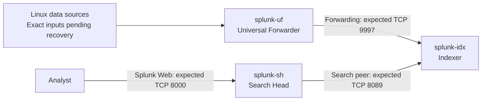
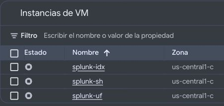

# Splunk Distributed Lab

A three-node Linux lab on Google Cloud, separating data collection, indexing and search. This portfolio documents the architecture, preserves reviewed configuration, and explains how to validate the data path without exposing operational credentials.

**Recovery in progress — not yet ready for cloud deletion.** All three VMs were observed stopped on **3 November 2026**. Cloud inventory has been inspected; guest files and live Splunk behavior have **not** yet been recovered or verified. This distinction is tracked in the [evidence register](evidence/README.md).

## Architecture



Roles come from the original lab description. Arrows describe the intended design; actual listeners, TLS and ingestion still require guest inspection. This is a single-indexer lab, with no demonstrated clustering or high availability.

| Node | Role | Observed machine | Source image | Boot disk | Observed state |
| --- | --- | --- | --- | --- | --- |
| `splunk-sh` | Search Head | e2-medium, 2 vCPU / 4 GB | CentOS Stream 10 | 20 GB balanced persistent disk | Stopped |
| `splunk-idx` | Indexer | e2-medium, 2 vCPU / 4 GB | CentOS Stream 10 | 20 GB balanced persistent disk | Stopped |
| `splunk-uf` | Universal Forwarder | e2-medium, 2 vCPU / 4 GB | CentOS Stream 10 | 20 GB balanced persistent disk | Stopped |

All nodes are in `us-central1-c` on the `default` VPC/subnet. These are observed lab choices, not a production sizing recommendation. Project identifiers, account names, live addresses and SSH keys are intentionally omitted.



*Original console capture, cropped to the VM names, zone and state. The crop excludes account, project and address columns. See the evidence register for scope and limitations.*

## What this project demonstrates

- Separation of collection, indexing and search responsibilities.
- A documented recovery process with explicit provenance and incomplete-check reporting.
- Read-only collection tooling and review of sensitive configuration before publication.
- A validation plan that follows data from the forwarder to an indexer and a search result.

Live validation results will be added only after they are observed. No performance, event-count or availability claims are made at this stage.

## Start here

| Task | Guide |
| --- | --- |
| Understand topology and network boundaries | [Architecture](docs/architecture.md) |
| Inspect the existing deployment | [Infrastructure inventory](docs/infrastructure.md) |
| Recover configuration without changing services | [Recovery runbook](docs/recovery.md) |
| Understand examples vs. recovered files | [Configuration](configs/README.md) |
| Prove forwarding, indexing and search | [Validation](docs/validation.md) |
| Diagnose missing data or search peers | [Troubleshooting](docs/troubleshooting.md) |
| Review decisions and improvements | [Lessons learned](docs/lessons-learned.md) |
| Protect sensitive information | [Security and redaction](SECURITY.md) |
| Review outstanding work before retiring GCP | [Preservation checklist](docs/preservation-checklist.md) |
| Continue in Spanish | [Guía en español](docs/guia-es.md) |

## Local checks

Python 3.9+ is sufficient for the repository tools; they have no external Python dependencies.

```sh
python3 -m unittest discover -s tests -v
python3 scripts/check_repo.py
```

These checks validate repository hygiene and sanitizer behavior. They do **not** test the live Splunk environment. Collection, review and promotion are separate steps; see the recovery runbook before running commands against a VM.

## Scope and attribution

This is a personal learning and portfolio project originally built for a technical assessment. It does not contain the assessment prompt, employer material, customer data, Splunk binaries or license files. It is not an official vendor or employer deployment.

The recorded cloud image does not establish compatibility with the installed Splunk version. That version and its supported operating systems still need verification. See [references](docs/references.md).
