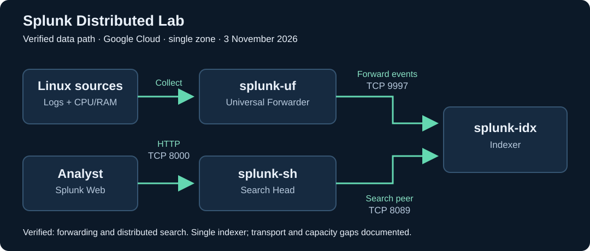
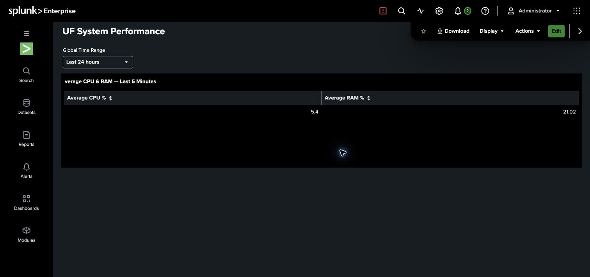

# Splunk Distributed Lab

A three-node Splunk Enterprise lab on Google Cloud. Follow Linux telemetry from collection to distributed search, then see how the lab recovered when the Search Head ran short of disk space.

[Architecture](#architecture) · [Verified results](#demonstrated-results) · [Disk recovery](#disk-capacity-case-study) · [Rebuild guide](docs/rebuild.md) · [Guía en español](docs/guia-es.md)

**Recovered on 3 November; live searches revalidated on 7 November 2026.** The original configuration, metrics script, schedule and Dashboard Studio definition are preserved with provenance. The original three VMs and the recorded validation are the basis for the examples below. [Current status and preservation limits](docs/preservation-checklist.md).

## Architecture



[Editable Mermaid source](docs/architecture.mmd) · [Architecture details](docs/architecture.md)

| Node | Responsibility | Observed environment |
| --- | --- | --- |
| `splunk-uf` | Monitor three Linux sources and forward to TCP 9997 | Universal Forwarder; `splunkfwd` service account |
| `splunk-idx` | Receive events, maintain `linux_os`, answer searches | Splunk Enterprise; `splunk` service account |
| `splunk-sh` | Splunk Web, distributed search and dashboard | Splunk Enterprise; `splunk` service account |

All three run Splunk 10.6.1.1 (build `b2ae2962645c`) on CentOS Stream 10, using `e2-medium` VMs with 2 vCPU and 4 GB RAM in `us-central1-c`. The [infrastructure inventory](docs/infrastructure.md) records the original storage layout. Vendor compatibility and production sizing are not established. It is a single-indexer deployment without high availability.

## Demonstrated results

- All three Splunk services were running after the owner-authorized boot.
- UF-to-IDX forwarding had an established TCP connection; the indexer listened on 9997.
- A Search Head query returned **129,310 events** over its recorded 24-hour interval, across `linux_boot`, `linux_messages` and `system_metrics`, with `splunk_server=splunk-idx`.
- The search peer was **Up / Successful / Healthy / Enabled**.
- A separate 30-minute query found six metric events, with CPU and RAM fields extracted in all six. The original dashboard displayed CPU **5.4%** and RAM **21.02%** at capture time.


These are observations at specific capture times, not throughput, durability or availability guarantees. The Search Head also reported yellow disk-space and I/O-wait warnings. [Validation details and limitations](docs/validation.md).

## Disk capacity case study

| Stage | What happened |
| --- | --- |
| Symptom | Splunk Web was reachable, but new searches were refused at the minimum free-space threshold. |
| Diagnosis | The filesystem holding the Search Head dispatch directory had fallen below the configured 5,000 MB floor. |
| Recovery | The boot disk, guest partition and XFS filesystem were extended. A new distributed search verified the repair. |
| Prevention | The [Cloud Monitoring policy examples](configs/examples/observability-v2/cloud-monitoring/README.md) detect low space and missing disk metrics independently of Splunk. [Controlled tests verified incident opening and recovery](configs/examples/observability-v2/cloud-monitoring/README.md#observed-validation). |

On **7 November 2026**, a completed 20-minute query found four metric events from `splunk-uf` on `splunk-idx`, latest **14:45:02 UTC**. SH had about **15.0 GB free** after the repair. The private archive contains **8,697,141 events** through its fixed cutoff; its local copy matches the fully validated server archive by size and SHA-256. No full restore has been tested.


## Original dashboard



The screenshot and XML preserve the original panel title, including its typo, and the original time-range behavior. [Dashboard review](docs/lessons-learned.md) explains improvements for a separate rebuild.

## Explore the project

| Topic | Material |
| --- | --- |
| Recovered source and provenance | [Configuration guide](configs/README.md), [manifest](configs/recovered/manifest.json) |
| Original data generator | [system_metrics.sh](scripts/original/system_metrics.sh), [five-minute cron schedule](configs/recovered/universal-forwarder/splunkfwd.crontab) |
| Rebuild in a separate environment | [Rebuild guide](docs/rebuild.md) |
| Extend monitoring and alerting | [Example dashboard and alert searches](configs/examples/observability-v2/README.md) |
| Infrastructure and access | [Inventory](docs/infrastructure.md), [network review](docs/network-review.md) |
| Evidence and validation | [Evidence register](evidence/README.md), [validation](docs/validation.md), [SPL queries](searches) |
| Recovery and security | [Recovery runbook](docs/recovery.md), [private event backup](docs/event-backup.md), [security](SECURITY.md) |
| Troubleshooting and lessons | [Troubleshooting](docs/troubleshooting.md), [lessons learned](docs/lessons-learned.md) |
| Español | [Guía breve](docs/guia-es.md) |

## Repository checks

Python 3.9+; no external Python dependencies:

```sh
python3 -m unittest discover -s tests -v
python3 scripts/check_repo.py
bash -n scripts/original/system_metrics.sh
```

Checks cover collection boundaries, sanitization, artifact integrity and dashboard syntax. They do not replace live Splunk validation or manual sensitive-data review.

## Scope and attribution

A personal portfolio project originally built for a technical assessment. It contains no assessment prompt, employer material, customer records, Splunk binaries or license files, and is not an official vendor or employer deployment. Raw recovery bundles, credentials and event exports remain outside GitHub. Published configurations are reviewed derivatives, not a production deployment package.
