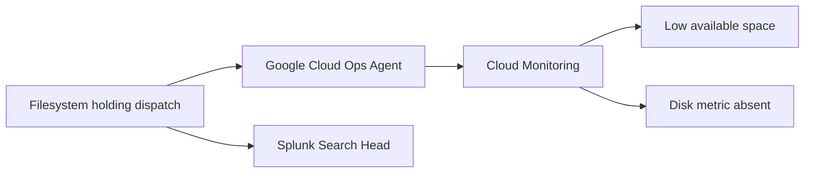

# Monitor Search Head disk capacity from Google Cloud

Splunk refuses to dispatch searches when the filesystem that holds its dispatch directory falls below the configured minimum. This can prevent a scheduled Splunk search from reporting the condition that stopped it. The Ops Agent sends disk metrics to Cloud Monitoring, where these policies evaluate them independently of Splunk.



| Policy | Condition | Where to look |
| --- | --- | --- |
| [Low space](disk-low.json) | Less than 8 GiB free for five minutes. Missing samples evaluate as inactive. | Confirm the available bytes and inspect growth on the dispatch volume. |
| [Missing metric](disk-missing.json) | No points for the same device for ten minutes. | Check the VM state, Ops Agent and write permissions. |

The 8 GiB threshold is an example. Set the threshold above the effective Splunk limit with enough room for expected growth during the retest window, ingestion latency and response time. A rapid burst can still exhaust the margin before the alert fires.

## Verify the source

1. Identify the filesystem and compare its available space with the Splunk minimum:

   ```bash
   dispatch=/opt/splunk/var/run/splunk/dispatch
   sudo findmnt -no SOURCE,FSTYPE --target "$dispatch"
   sudo df -B1 --output=avail "$dispatch"
   sudo /opt/splunk/bin/splunk btool server list diskUsage | grep -F minFreeSpace
   ```

2. In Metrics Explorer, inspect `agent.googleapis.com/disk/bytes_used` for the VM and select `state=free`. Confirm which `device` label matches the filesystem, and compare a recent data point with the output from `df`. Device paths can differ between VMs. Resolve any significant difference before relying on the threshold.
3. If the agent is running but the metric has no points, inspect its health checks and metric exporter logs. A `monitoring.timeSeries.create` denial points to the VM's service account permissions. Verify the Monitoring API, write scope and `roles/monitoring.metricWriter`. Missing log-write permission is a separate issue. Review role scope before granting access to an identity shared by several VMs.

## Create and validate the policies

1. Copy both JSON files. Replace `EXAMPLE_INSTANCE_ID` and `EXAMPLE_DEVICE` with the numeric VM ID and the device label you verified. In your monitoring project, check that policies with the same display names do not already exist. Create each policy once with `gcloud monitoring policies create --project="$MONITORING_PROJECT" --policy-from-file=FILE`.
2. The templates open incidents in Cloud Monitoring. During testing, leave their notification channels empty. Temporarily raise the low-space threshold above the current reading, wait for the retest window and check that an incident opens. Restore the intended threshold and confirm that the incident closes. This test uses the real disk metric without writing test data to the volume.
3. For the absence policy, confirm that it observes at least one data point after creation. Test loss of a disposable time series or use a maintenance window for the agent. Verify that an absence incident opens, then that it closes after points resume. VM lifecycle state can affect absence detection, so use a separate VM status check if you need to detect a stopped VM.
4. Attach an approved notification channel after testing if operators need delivery outside the console.

## Observed validation

On 25 November 2026, the Ops Agent was running but its disk series was empty because the attached service account lacked permission to publish metrics. Granting Monitoring Metric Writer restored the series. Its available-space reading agreed with Linux before alert testing began.

| Exercise | Observed result | Setting after the test |
| --- | --- | --- |
| Low disk space | A temporary threshold above the current reading opened an incident without filling the disk. The diagnostic run included a two-minute window and one-minute alignment. The test incidents were closed after the original policy settings were restored. | 8 GiB for five minutes |
| Missing disk metrics | A two-minute test window detected a controlled interruption of the metrics collector. The collector restarted automatically, new points arrived, and Cloud Monitoring closed the incident. Splunk stayed active during the test. | Ten minutes without points |

Both policies were confirmed enabled after testing. Incident status was checked in Cloud Monitoring with no external notification channels attached. The exercises verified detection and recovery with temporary test settings. The normal retest windows were restored and verified separately.

## If Splunk has already stopped dispatching

Check available bytes on the dispatch filesystem. If the disk needs to grow, verify a recent backup and follow the provider's disk resize procedure. Compare the cloud disk, guest partition and filesystem sizes independently. On an XFS system, extend the mounted filesystem after the guest recognizes the larger partition. Rerun an actual Splunk search and check scheduler results after the repair.

- [Splunk disk usage limits](https://help.splunk.com/en/data-management/manage-splunk-enterprise-indexers/9.3/manage-index-storage/set-limits-on-disk-usage)
- [Google Cloud Persistent Disk resize](https://docs.cloud.google.com/compute/docs/disks/resize-persistent-disk)
- [Ops Agent metrics](https://docs.cloud.google.com/monitoring/api/metrics_opsagent)
- [Ops Agent authorization](https://docs.cloud.google.com/monitoring/agent/ops-agent/authorization)
- [Cloud Monitoring metric absence](https://docs.cloud.google.com/monitoring/alerts/metric-absence)
