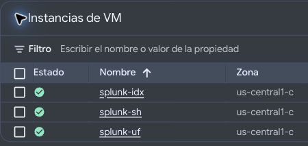

# Infrastructure inventory

Inspected in the authenticated Google Cloud console on **2026-11-03**, using read-only views, followed by owner-authorized boot and temporary SSH access. This is a sanitized transcription, not a raw API export.

| Property | splunk-sh | splunk-idx | splunk-uf |
| --- | --- | --- | --- |
| Initial → validated state | Stopped → Running | Stopped → Running | Stopped → Running |
| Zone | us-central1-c | us-central1-c | us-central1-c |
| Machine | e2-medium | e2-medium | e2-medium |
| vCPU / memory | 2 / 4 GB | 2 / 4 GB | 2 / 4 GB |
| Image | centos-stream-10-v20261024 | centos-stream-10-v20261024 | centos-stream-10-v20261024 |
| Architecture | x86_64 | x86_64 | x86_64 |
| VPC / subnet | default / default | default / default | default / default |
| NIC | nic0 | nic0 | nic0 |
| Network tag | splunk-sh | splunk-idx | splunk-uf |
| Boot disk | 20 GB pd-balanced | 20 GB pd-balanced | 20 GB pd-balanced |
| Disk deletion behavior | Delete with VM | Delete with VM | Delete with VM |
| VM deletion protection | Disabled | Disabled | Disabled |
| Snapshot schedule shown | default-schedule-1 | default-schedule-1 | default-schedule-1 |
| Secure Boot | Disabled | Disabled | Disabled |
| vTPM / integrity monitoring | Enabled / enabled | Enabled / enabled | Enabled / enabled |

Guest `/etc/os-release` confirmed CentOS Stream 10. All nodes report Splunk 10.6.1.1, build `b2ae2962645c`. SH/IDX use `/opt/splunk` and account `splunk`; UF uses `/opt/splunkforwarder` and `splunkfwd`. All services were active after boot. External addresses were assigned when the VMs started and are intentionally omitted.

At capture, SH disk usage was 54% (9.2 GB available), IDX 53% (9.3 GB available), and UF 20% (16 GB available). SH local health still reported yellow disk-space and I/O-wait warnings; see [validation](validation.md).

The console showed a daily snapshot schedule beginning between 17:00 and 18:00 in its displayed timezone. A schedule is **not evidence of a complete or restorable backup**.

The standard-snapshot list contained one available scheduled snapshot, associated with the Search Head's original boot disk. It was created on **2026-11-02 at 11:38:31 UTC-06:00**, showed 1.24 GB snapshot size and a 20 GB source disk. No standard snapshots for the Indexer or Universal Forwarder appeared in that list. Archive, instant and recycled snapshots were not inspected. Snapshot contents and restore success remain unverified; this is not a backup of the complete distributed lab.

## Missing inventory

The project's **Metadata** tab displayed no project key/value entries during this inspection. This does not rule out startup configuration in instance metadata or guest files. The Search Head detail page showed `enable-osconfig = TRUE` in its custom metadata.

See the separately captured [network review](network-review.md) for the seven visible VPC firewall rules and the limitation on inherited-policy visibility.

- Guest firewall rules, comprehensive package inventory and vendor compatibility validation.
- Remaining instance startup metadata, other snapshot categories, effective IAM, routes and hierarchical firewall policies.
- Indexed-event export verification, independent backup and a tested restore.

Do not delete VMs or the project while these preservation tasks remain open.
