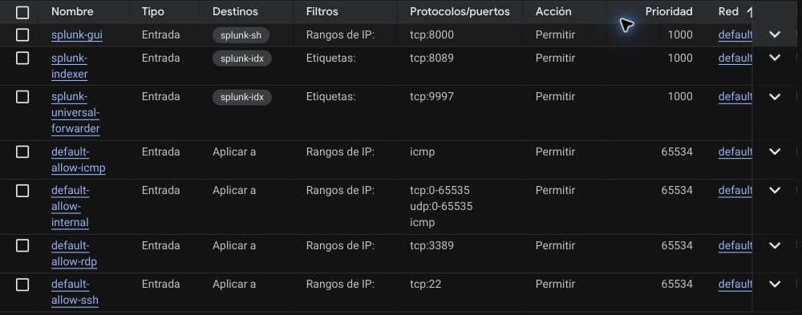

# Network review

Observed VPC ingress rules on 2026-11-03. No rules were changed.

| Rule | Source | Target | Allowed traffic | Priority | Logging |
| --- | --- | --- | --- | --- | --- |
| splunk-gui | One administrator IPv4 address, redacted | tag `splunk-sh` | TCP 8000 | 1000 | Off |
| splunk-indexer | tag `splunk-sh` | tag `splunk-idx` | TCP 8089 | 1000 | Off |
| splunk-universal-forwarder | tag `splunk-uf` | tag `splunk-idx` | TCP 9997 | 1000 | Off |
| default-allow-icmp | Any IPv4 source | All instances | ICMP | 65534 | Off |
| default-allow-internal | Default VPC internal range, redacted | All instances | All TCP/UDP ports and ICMP | 65534 | Off |
| default-allow-rdp | Any IPv4 source | All instances | TCP 3389 | 65534 | Off |
| default-allow-ssh | Any IPv4 source | All instances | TCP 22 | 65534 | Off |

The source values are not expanded in this screenshot; the table above was transcribed from the console's readable table. Personal addresses and project identifiers have been omitted.

## Findings

The custom rules express the expected SH-to-IDX and UF-to-IDX relationships. However, `default-allow-internal` also permits broad internal traffic; the presence of narrowly targeted rules alone does not establish internal isolation. The default SSH and RDP rules accept any IPv4 source at the VPC-rule level. A rule does not prove actual Internet reachability or that an RDP service exists on these Linux machines.

The console reported missing `compute.organizations.listAssociations` permission, so inherited firewall policies could not be inspected. Effective exposure remains unverified. Guest firewalls, external addresses while running and listening services also require inspection.

For a future redesign, use scoped administrative access, remove unnecessary protocol allowances, review inherited policies and enable appropriate logging. These are recommendations, not changes applied to the original lab.
